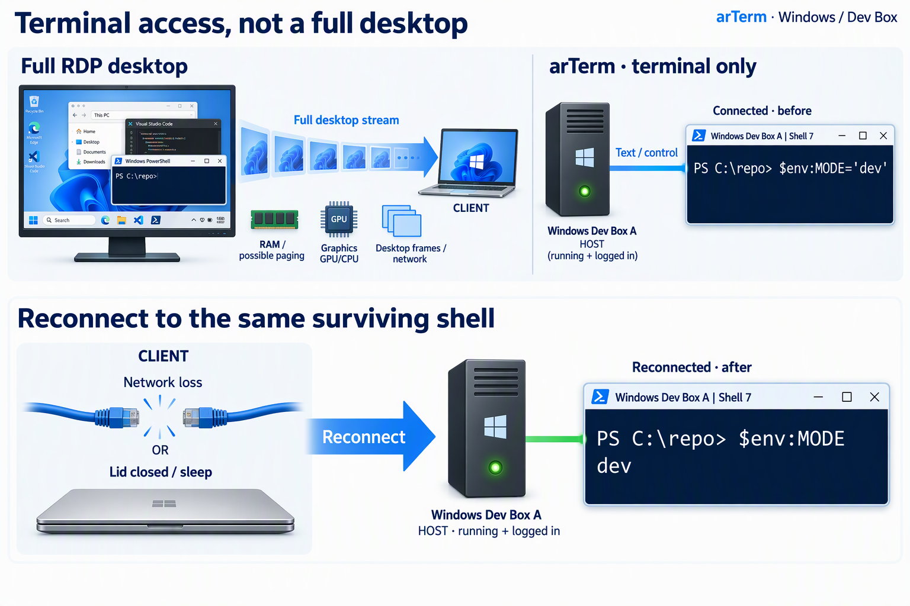

# arTerm: terminal remoto persistente do Windows após desconexão

<a id="languages"></a>
<details>
<summary>Languages (16)</summary>

[English](../../README.md) | [简体中文](README.zh-CN.md) | [繁體中文](README.zh-TW.md) | [日本語](README.ja.md) | [한국어](README.ko.md) | [Español](README.es.md) | [Português (Brasil)](README.pt-BR.md) | [Français](README.fr.md) | [Deutsch](README.de.md) | [Italiano](README.it.md) | [Русский](README.ru.md) | [Türkçe](README.tr.md) | [Tiếng Việt](README.vi.md) | [Bahasa Indonesia](README.id.md) | [हिन्दी](README.hi.md) | [العربية](README.ar.md)

</details>

Se o cliente ou a VPN desconectar, builds e agentes continuam no Windows remoto. Volte ao mesmo shell.

[Configurar](#native-setup) · [Comprovar o mesmo shell](#native-proof) · [Verificar download e confiança (inglês)](../../DEVELOPMENT-INSTALL.md)



*Ilustração do fluxo com rótulos em inglês, não captura real nem prova de teste.*

- **O trabalho continua sem o cliente.** Builds, agentes e comandos demorados continuam no host Windows remoto ao fechar o cliente, perder a VPN ou reiniciar o notebook.
- **Volte ao trabalho, não a um shell vazio.** Reconecte ao mesmo processo de shell interativo, preservando variáveis e diretório de trabalho.
- **Veja o que aconteceu enquanto estava fora.** A reconexão reproduz a saída retida do terminal; a retenção é limitada, pode haver lacunas e não é um log completo.

## Requisitos e confiança

arTerm é software nativo do Windows escrito em Rust. As duas pontas precisam de Windows, da mesma conta GitHub nos túneis e de conexões de saída permitidas. O host deve continuar funcionando com a sessão Windows aberta. Reinício, logoff, falha, desligamento ou exit no shell remoto encerram o processo sem recuperação. Para tarefas não interativas comuns, o canal remoto já aprovado pode bastar.

Os downloads x64/ARM64 têm assinatura de desenvolvimento, não confiança pública de produção. Antes de instalar ou adicionar confiança, verifique somente para leitura no PowerShell:

1. Defina `$archive` como o caminho do ZIP baixado. `Get-FileHash -LiteralPath $archive -Algorithm SHA256` fornece `.Hash`: compare com o ZIP de mesmo nome na `SHA256SUMS` pública dessa versão, não na lista extraída. Se faltar ou diferir, pare; a igualdade não prova segurança.
2. Após conferir o ZIP, extraia-o e abra o PowerShell no diretório extraído. `Get-FileHash -LiteralPath .\arTerm-Dev.cer -Algorithm SHA256` calcula o hash do certificado; `$certificate = [System.Security.Cryptography.X509Certificates.X509Certificate2]::new((Resolve-Path -LiteralPath .\arTerm-Dev.cer).Path)` guarda o objeto do certificado sem exibir os campos; execute `$certificate.Subject; $certificate.Thumbprint` para imprimir o nome e a impressão digital. Compare com [valores fixados e verificação (inglês)](../../DEVELOPMENT-INSTALL.md#certificate-identity), não só o nome, sem importar confiança.
3. Defina `$file`, um por vez, como `arTerm-Client-Setup.exe`, `arTerm-Host-Setup.exe`, `arterm.exe`, `arterm-host.exe`. `Get-AuthenticodeSignature -LiteralPath $file` mostra `.Status` e `.SignerCertificate`. Os quatro devem ser `Valid`, com impressão digital e bytes do certificado iguais ao CER fixado. Complete a [inspeção de identidade/assinaturas (inglês)](../../DEVELOPMENT-INSTALL.md#inspect-extracted-executable-signatures-without-running-them) antes de executar qualquer EXE.

Confiança manual exige aprovação explícita separada e permissão da política; depois, verifique novamente. Não-`Valid`, signatário desconhecido ou diferença: pare, sem contornar avisos ou controles. O host exige Windows Script Host/VBScript permitido.

**Mantenha os dados da sessão privados:** saída retida, histórico normal do shell e arquivos de recuperação podem conter comandos, caminhos, código ou segredos. Proteja-os nos dois computadores e remova informações sensíveis antes de compartilhar logs, capturas ou pacotes de suporte. A proteção de credenciais por DPAPI não significa que todos os arquivos sejam criptografados ou sem conteúdo. As exclusões de conteúdo dos diagnósticos de prontidão são mais restritas.

<a id="native-setup"></a>

## Configuração

[Referência técnica (inglês)](../../QUICKSTART.md)

No host, execute arTerm-Host-Setup.exe e abra um novo PowerShell:

```powershell
arterm-host setup --name my-devbox
```

Conclua o login do túnel e guarde o comando de registro mostrado. Instale arTerm-Client-Setup.exe localmente, abra um novo PowerShell e use a mesma conta do GitHub. Execute exatamente o registro impresso pelo host com o caminho real informado. O instalador já inicializa o cliente; arterm setup não é necessário. Com um nome de sessão novo, conecte localmente:

```powershell
arterm connect my-devbox MyProof --shell powershell
```

<a id="native-proof"></a>

## Comprovar o mesmo shell

No PowerShell remoto, execute e anote o PID e a pasta:

```powershell
$artermProof = 'kept-on-host'
$artermPid = $PID
$artermCwd = (Get-Location).Path
$PID; $artermProof; (Get-Location).Path
```

Pressione Ctrl+] para desconectar apenas o cliente. Se o terminal capturar o atalho, feche só a aba do cliente local. Mantenha o host ligado e o usuário conectado. Repita localmente o mesmo comando:

```powershell
arterm connect my-devbox MyProof --shell powershell
```

No PowerShell remoto reconectado:

```powershell
$PID; $artermProof; (Get-Location).Path
($PID -eq $artermPid) -and ($artermProof -eq 'kept-on-host') -and ((Get-Location).Path -eq $artermCwd)
```

O esperado é o mesmo PID, kept-on-host, a mesma pasta e True. Use o mesmo comando nas próximas conexões para continuar o trabalho. Para encerrar o teste, digite exit no shell remoto: o processo termina e seu estado não poderá ser retomado.

## Recuperação e desfazer

Se falhar, execute arterm doctor my-devbox e confira contas e rede; use arterm --login para recuperar explicitamente o login do cliente quando necessário. Não apague registros de recuperação nem reinstale um host em execução. Por padrão, o atualizador recusa interromper sessões ativas. No host, arterm-host stop --disable mantém o host parado; arterm-host start inicia novamente, mas não recupera shells perdidos. A desinstalação mantém dados; o guia explica como remover a confiança no certificado.

<a id="limites"></a>
<a id="controle-local-avançado"></a>

send/read gerenciados exigem nova sessão PowerShell/pwsh compatível e identidade local confiável correspondente à conexão. Shells existentes não recebem a integração. Na branch de desenvolvimento, a validação da entrada direta e a revisão independente dos arquivos de transferência continuam pendentes; a publicação não qualifica todas as capacidades da branch e versões desconhecidas seguem não verificadas. TUIs arbitrárias, arquiteturas mistas e Windows Sandbox não são certificados. Desbloquear arquivos automaticamente não significa que sejam seguros. Veja os detalhes no guia em inglês.

[Referência técnica (inglês)](../../QUICKSTART.md#automation) · [Verificar download e confiança (inglês)](../../DEVELOPMENT-INSTALL.md) · [Signing](../../SIGNING.md) · [English README](../../README.md)
